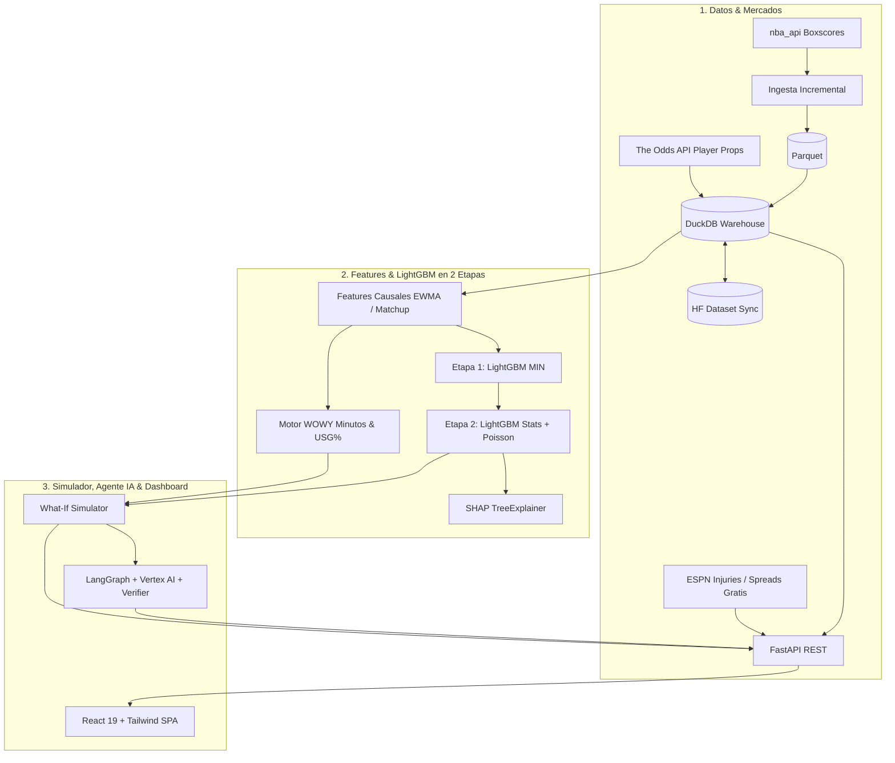

<div align="center">

# 🏀 NBA Stats — Props Board & What-If Simulator

**Plataforma de análisis de Player Props NBA, simulación de escenarios dinámicos (lesiones, B2B, WOWY) y tracking automático de rendimiento (Win Rate & ROI) impulsada por LightGBM, SHAP y LangGraph.**

[](https://python.org)
[](https://duckdb.org)
[](https://lightgbm.readthedocs.io)
[](https://fastapi.tiangolo.com)
[](https://react.dev)

<p align="center">
  <a href="#cómo-usar-la-app-guía-práctica">Cómo Usar la App</a> •
  <a href="#inicio-rápido-local">Inicio Rápido</a> •
  <a href="#flujo-diario-recomendado">Flujo Diario</a> •
  <a href="#despliegue-en-la-nube-vercel--hugging-face">Deploy Gratis</a> •
  <a href="#comandos-cli">CLI</a> •
  <a href="#arquitectura">Arquitectura</a>
</p>

---

</div>

## ¿Qué hace este proyecto?

**NBA Stats** combina un **tablero visual de Player Props** (estilo Outlier) con un **motor de Machine Learning en 2 etapas** (`LightGBM` + `SHAP`) y un **simulador What-If / WOWY** (*With Or Without You*) para proyectar estadísticas NBA (`MIN`, `PTS`, `REB`, `AST`, `3PM`, `STL`, `BLK`, `TOV` y combinadas `RA`, `PR`, `PA`, `PRA`) ajustadas por lesiones reales, back-to-backs, localía y defensa rival.

Además incluye **paper trading automático**: guarda las proyecciones contra líneas reales de casas de apuestas y las califica automáticamente al día siguiente (`WIN / LOSS / PUSH / VOID`) para medir **Win Rate, ROI y unidades netas** con datos reales.

---

## Cómo Usar la App (Guía Práctica)

La interfaz web tiene **3 pestañas principales** y una **barra superior inteligente**:

### 1. Pestaña **Props** (Tablero de Player Props)

Es el centro de trabajo diario para analizar líneas reales de jugadores:

1. **Capturar líneas del día:**
   - Elegí el modo de créditos de *The Odds API* antes de tocar **Capturar líneas**:
     - **Ahorro (`PTS + PRA`):** consume solo **2 créditos por partido** (ideal para cuidar el plan gratuito de 500 créditos/mes).
     - **Completo (10 stats):** trae `PTS`, `REB`, `AST`, `3PM`, `BLK`, `TOV`, `RA`, `PR`, `PA`, `PRA` (**10 créditos por partido**).
   - Los **Spreads y Totales** de cada partido se obtienen **100% gratis** desde ESPN (0 créditos).
2. **Filtros y ordenamiento:**
   - Filtrá por **stat**, **lado** (`OVER / UNDER`), **partido** o **equipo**.
   - Navegá la lista rápidamente con las flechas **`↑` / `↓`** del teclado.
   - Tres formas de ordenar el tablero:
     - **Mayor Convicción (0–100):** fórmula transparente = `55% Hit Rate L10 + 25% Hit Rate L5 + 15 pts si el modelo ML coincide con el lado`, menos `-10 pts` si hay riesgo de *blowout* en un `OVER` (spread ≥ 11.5).
     - **Mejor Hit Rate L10:** porcentaje de aciertos reales del jugador contra esa línea en sus últimos 10 partidos.
     - **Mayor Edge ML:** diferencia absoluta entre la proyección del modelo LightGBM y la línea de la casa (`Proyección ML - Línea`).
3. **Panel visual de detalle (derecha):**
   - **Gráfico de barras de últimos 20 partidos:** verde = acierto, rojo = fallo, con línea punteada en el valor de la apuesta.
   - **Splits rápidos:** `L5`, `L10`, `L20`, `Local` y `Visitante`.
   - **Controles interactivos:**
     - Probá una **línea alternativa** (ej. subir o bajar `±1` punto) o cambiá `OVER / UNDER` al instante.
     - Activá el filtro **Sin jugador (WOWY)** seleccionando un compañero lesionado para ver cómo rindió el jugador **únicamente en los partidos donde ese compañero no jugó**.
   - **Contexto del partido:** defensa rival (Def Rating & Pace Rank), spread/total de Vegas, alerta de *blowout* y reporte de lesiones de ESPN.

> **Tip práctico:** No mires solo un número aislado. Los extremos absolutos (ej. L10 del 100% con cuotas muy castigadas) suelen sufrir regresión a la media; buscá **convergencia** entre Hit Rate L10 sólido (70–80%), acuerdo del modelo ML (`Edge` moderado-alto) y sin riesgo de *blowout* ni bajas inesperadas.

---

### 2. Pestaña **Partidos** (Simulador What-If / Boxscore)

Te permite simular el boxscore completo de cualquier partido del calendario:

- Seleccioná un partido en la barra superior (o usá **Manual** para armar cualquier cruce).
- El sistema aplica automáticamente las bajas oficiales (`OUT`) del reporte de **ESPN** y marca qué equipos están en **Back-to-Back (B2B)**.
- **Simulación WOWY en vivo:** tildá o destildá cualquier jugador de cualquiera de los dos equipos como **OUT** para ver cómo el simulador redistribuye automáticamente minutos, tiros y tasa de uso (`USG%`) entre sus compañeros (costo `$0`, 100% determinístico).
- Hacé clic en cualquier jugador para ver sus **factores SHAP** (qué variables suman o restan a la proyección) o pedir un **análisis táctico con IA**.

---

### 3. Pestaña **Rendimiento** (Paper Trading, Win Rate & ROI)

Evalúa objetivamente cómo viene rindiendo el sistema con apuestas reales registradas antes de cada jornada:

- Muestra **Win Rate %**, **ROI %**, **Unidades netas** y conteo de `WIN / LOSS / PUSH / VOID / PENDING`.
- Desglose automático por **estadística** (`PTS`, `PRA`, `REB`, etc.), por **fecha** y por **rango de Edge ML**.
- Cuando termina una jornada, tocá **Sincronizar** (o ejecutá la ingesta) para descargar los boxscores reales y calificar automáticamente todos los picks pendientes.

---

### 4. Barra Superior (Buscador + Agente IA)

- **Modo Jugador:** buscá cualquier jugador activo para saltar directo a su partido y proyección.
- **Modo IA:** hacé preguntas en lenguaje natural (ej. *"¿Cómo proyecta Jamal Murray contra LAL en B2B si falta Nikola Jokic?"*). El agente **LangGraph + Vertex AI** corre el simulador numérico primero y pasa la respuesta por un **Grounding Verifier** anti-alucinación para garantizar que los números coincidan exactamente con el modelo.

---

## Flujo Diario Recomendado

1. **Sincronizar datos:** tocá el botón **Sincronizar** en la barra superior (descarga los boxscores de anoche en DuckDB y califica los picks pendientes en **Rendimiento**).
2. **Revisar lesiones y partidos:** abrí **Partidos** para ver los cruces del día, B2B y bajas confirmadas.
3. **Capturar líneas:** pasá a **Props**, elegí modo **Ahorro** o **Completo** y tocá **Capturar líneas**.
4. **Filtrar y validar:** usá `↑` / `↓` para recorrer las mejores oportunidades, verificá el gráfico L10/L20, los splits Local/Visitante y probá el filtro **Sin jugador (WOWY)** si hay estrellas afuera.

---

## Inicio Rápido (Local)

### Prerrequisitos
- **Python 3.12+** y [**uv**](https://github.com/astral-sh/uv)
- **Node.js 18+** y **npm**

### 1. Clonar e instalar dependencias

```bash
git clone https://github.com/gonzalo-agostino/nba-stats.git
cd nba-stats

# Backend Python
uv sync

# Frontend React
cd frontend
npm install
cd ..
```

### 2. Configurar variables de entorno

```bash
cp .env.example .env
```

Editá `.env` según lo que vayas a usar:

```dotenv
# Almacenamiento local
NBA_STATS_DATA_DIR=data
NBA_STATS_LOG_LEVEL=INFO

# The Odds API (requerido para capturar líneas reales en la pestaña Props)
THE_ODDS_API_KEY=tu_api_key_de_the_odds_api

# Vertex AI / Gemini (opcional — solo para el chat del Agente IA)
GOOGLE_CLOUD_PROJECT=tu-proyecto-gcp
GOOGLE_CLOUD_LOCATION=us-central1
VERTEX_MODEL_NAME=gemini-3.8-flash

# Deploy en la nube (opcional — Vercel + Hugging Face Spaces)
CORS_ORIGINS=https://tu-app.vercel.app
HF_DATASET_REPO=tu-usuario/nba-stats-data
HF_TOKEN=hf_xxxxxxxxx
```

### 3. Cargar datos y entrenar modelos (solo la primera vez)

```bash
uv run nba-stats ingest
uv run nba-stats build-features
uv run nba-stats train
```

### 4. Levantar la aplicación

**En Windows (1 clic):** hacé doble clic en [`start-nba-stats.bat`](start-nba-stats.bat). Levanta el backend (`:8000`), el frontend (`:5173`), espera el healthcheck y abre el navegador automáticamente.

**Manual (cualquier OS):**

```bash
# Terminal 1 — Backend FastAPI (http://127.0.0.1:8000)
uv run nba-stats serve --reload

# Terminal 2 — Frontend Vite (http://localhost:5173)
cd frontend && npm run dev
```

- Swagger UI: [http://127.0.0.1:8000/docs](http://127.0.0.1:8000/docs)
- Healthcheck: [http://127.0.0.1:8000/api/v1/health](http://127.0.0.1:8000/api/v1/health)

---

## Despliegue en la Nube (Vercel + Hugging Face)

El proyecto está listo para correr **100% gratis** en la nube con persistencia de DuckDB y modelos en un Dataset privado de Hugging Face:

### 1. Subir datos y modelos a Hugging Face Dataset
Creá un Dataset privado en Hugging Face (ej. `tu-usuario/nba-stats-data`), agregá `HF_DATASET_REPO` y `HF_TOKEN` en `.env`, y ejecutá:

```bash
uv run python scripts/upload_to_hf.py
```

### 2. Desplegar el Backend en Hugging Face Spaces (Docker)

```bash
uv run python scripts/deploy_hf_space.py tu-usuario/nba-stats-api
```

El script crea el Space Docker, configura automáticamente tus secrets (`HF_TOKEN`, `HF_DATASET_REPO`, `THE_ODDS_API_KEY`, etc.) y sube el `Dockerfile` y el código del backend. Tu API quedará en:
`https://<tu-usuario>-nba-stats-api.hf.space`

### 3. Desplegar el Frontend en Vercel
1. Importá este repositorio en [Vercel](https://vercel.com).
2. En **Root Directory**, seleccioná `frontend` (el archivo [`frontend/vercel.json`](frontend/vercel.json) ya configura los rewrites de SPA).
3. En **Environment Variables**, agregá:
   - `VITE_API_BASE_URL` = `https://<tu-usuario>-nba-stats-api.hf.space`
4. Hacé deploy y, si querés restringir CORS en el backend, agregá la URL de Vercel en la variable `CORS_ORIGINS` del Space.

---

## Comandos CLI

```bash
# Ingesta incremental de boxscores y rosters desde nba_api
uv run nba-stats ingest

# Ver estado actual del warehouse DuckDB
uv run nba-stats status

# Consultar últimos partidos de un jugador
uv run nba-stats player "Nikola Jokic" --limit 5

# Construir features causales (anti-leakage) y entrenar modelos LightGBM
uv run nba-stats build-features
uv run nba-stats train

# Simulación What-If desde terminal (costo LLM = $0)
uv run nba-stats simulate "Jamal Murray" --opp LAL --out "Nikola Jokic" --b2b

# Consulta en lenguaje natural al Agente LangGraph
uv run nba-stats ask "¿Cómo proyecta Jamal Murray contra LAL en B2B si falta Nikola Jokic?"

# Levantar servidor API
uv run nba-stats serve --reload
```

---

## Arquitectura



### Estructura del Proyecto

```text
nba-stats/
├── configs/                  # YAML de ingesta, features y entrenamiento
├── data/                     # Parquet + DuckDB local (gitignored)
├── artifacts/                # Modelos LightGBM entrenados (gitignored)
├── frontend/                 # SPA React 19 + TypeScript + Tailwind CSS
│   ├── src/components/       # PropsBoardView, PerformanceView, TeamBoxscoreTable, etc.
│   ├── src/lib/api.ts        # Cliente REST tipado (usa VITE_API_BASE_URL)
│   └── vercel.json           # Configuración de rutas SPA para Vercel
├── scripts/
│   ├── upload_to_hf.py       # Sube DuckDB y modelos a HF Dataset
│   └── deploy_hf_space.py    # Despliega el backend Docker a HF Spaces
├── src/nba_stats/
│   ├── api/                  # FastAPI (app.py, odds.py, slate.py, injuries.py)
│   ├── data/                 # Ingesta nba_api, DuckDB schema y hf_sync.py
│   ├── features/             # Pipeline SQL anti-leakage y motor WOWY
│   ├── ml/                   # Entrenamiento LightGBM, evaluación y SHAP
│   ├── simulator/            # Motor What-If determinístico
│   ├── agent/                # Agente LangGraph + Grounding Verifier
│   └── cli.py                # CLI Typer
├── Dockerfile                # Imagen del backend para HF Spaces
├── start-nba-stats.bat       # Launcher local de 1 clic en Windows
└── pyproject.toml
```

---

## Pruebas y Calidad de Código

```bash
# Tests unitarios e integración
uv run pytest -v

# Linter Python
uv run ruff check src tests

# Build y verificación TypeScript del frontend
cd frontend && npm run build
```

---

## Licencia

Distribuido bajo la licencia **MIT**.
