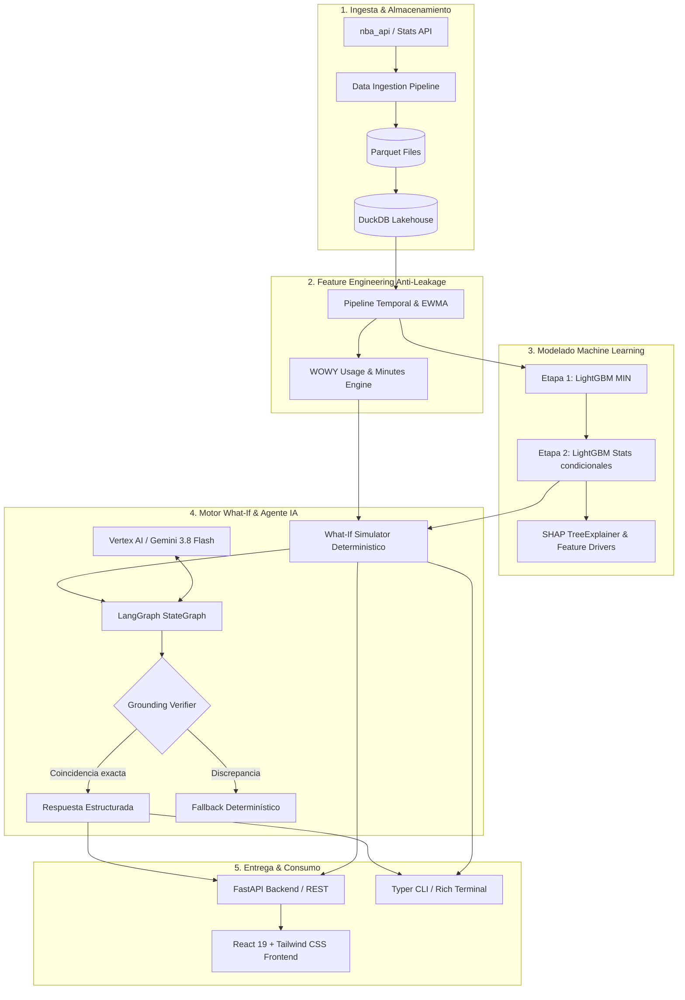

<div align="center">

# 🏀 NBA Stats & What-If Simulator

**Predicción de estadísticas de jugadores NBA y simulador de escenarios dinámicos impulsado por Machine Learning y Agentes de IA.**

[](https://python.org)
[](https://duckdb.org)
[](https://lightgbm.readthedocs.io)
[](https://cloud.google.com/vertex-ai)
[](https://fastapi.tiangolo.com)
[](https://react.dev)

<p align="center">
  <a href="#características-principales">Características</a> •
  <a href="#arquitectura-del-sistema">Arquitectura</a> •
  <a href="#guía-de-inicio-rápido">Inicio Rápido</a> •
  <a href="#comandos-cli">CLI</a> •
  <a href="#interfaz-web--api">Dashboard Web</a> •
  <a href="#estructura-del-proyecto">Estructura</a>
</p>

---

</div>

## 🌟 Resumen del Proyecto

**NBA Stats & What-If Simulator** es una plataforma integral de análisis y predicción de rendimiento deportivo en la NBA. Modela proyecciones estadísticas precisas (`MIN`, `PTS`, `REB`, `AST`, `STL`, `BLK`, `TOV`, `PF`, `FGA`, `FTM` y combinadas `PRA`, `PR`, `PA`) bajo escenarios dinámicos del mundo real: **lesiones de compañeros, suspensiones, cambios de rotación, fatiga por back-to-back (B2B), localía y ritmo de juego**.

El sistema integra:
1. **Data Lakehouse Local Vectorizado:** `DuckDB` + `Parquet` para ingesta incremental ultrarrápida y consultas analíticas de alto rendimiento.
2. **Feature Engineering Anti-Leakage:** Ventanas temporales estrictamente causales (EWMA, rolling stats, ajustes por ritmo y rating defensivo).
3. **Machine Learning en 2 Etapas:** Modelo `LightGBM` donde la Etapa 1 predice minutos (`MIN`) y la Etapa 2 condiciona las estadísticas al tiempo en cancha, empleando objetivos de regresión `Poisson` para estadísticas de baja frecuencia (`STL`, `BLK`, `TOV`, `PF`, `FTM`).
4. **Explicabilidad con SHAP:** Descomposición transparente del impacto de cada variable (ej. fatiga, bajas de compañeros, matchup) en la proyección final.
5. **Simulador de Escenarios WOWY (With / Without You):** Redistribución de minutos y tasa de uso (USG%) sin costo de inferencia LLM ($0 compute cost).
6. **Agente IA con LangGraph + Vertex AI:** Procesamiento de consultas en lenguaje natural con verificación determinística anti-alucinación (*Grounding Guardrail*).
7. **Aplicación Web Moderna:** Dashboard reactivo desarrollado en React 19, TypeScript, Tailwind CSS y FastAPI.

---

## 🏗️ Arquitectura del Sistema



---

## ⚡ Características Principales

### 🎯 Modelado Estadístico en 2 Etapas
* **Etapa 1 (Minutos):** Predice la rotación esperada de minutos basada en antecedentes recientes, días de descanso y ausencias de compañeros.
* **Etapa 2 (Estadísticas por minuto/partido):** Predice puntos, rebotes, asistencias, robos, bloqueos, pérdidas, etc., condicionados por los minutos predichos.
* **Objetivo Poisson:** Modela variables discretas de recuento bajo (`STL`, `BLK`, `TOV`, `PF`) evitando que colapsen a mediana 0.
* **Validación Temporal (Walk-Forward):** Backtesting con ventanas expansivas estrictamente causales, garantizando cero data leakage hacia el pasado.

### 🔄 Motor WOWY (*With / Without You*)
* Calcula deltas históricos de minutos y tasa de uso (USG) cuando uno o más compañeros están ausentes.
* Si falta una estrella del equipo (ej. *Nikola Jokic*), el simulador redistribuye dinámicamente minutos y tiros entre los compañeros de rotación (*Jamal Murray*, *Michael Porter Jr.*).

### 🤖 Agente LangGraph Verificado (Anti-Hallucination)
* Orquesta flujos conversacionales mediante un `StateGraph` de LangGraph:
  1. `parse_query`: Extracción de entidades y contexto (jugador, rival, condición local, B2B, ausencias).
  2. `resolve_entities`: Resolución difusa de nombres contra plantillas activas de la NBA.
  3. `run_ml_simulation`: Ejecución del motor determinístico ($0 costo de tokens).
  4. `explain_projection`: Generación del análisis táctico mediante Gemini en Vertex AI.
  5. `verify_output`: **Filtro de verificación estricto** que corrobora que las cifras citadas por el LLM coincidan exactamente con la predicción del modelo numérico.

---

## 🚀 Guía de Inicio Rápido

### Prerrequisitos
* **Python 3.12+**
* [**uv**](https://github.com/astral-sh/uv) (Recomendado para gestión ultrarrápida de dependencias)
* **Node.js 18+** & **npm**

### 1. Clonar e Instalar Entorno Python

```bash
git clone https://github.com/gonzalo-agostino/nba-stats.git
cd nba-stats

# Instalar dependencias con uv
uv sync
```

### 2. Configurar Variables de Entorno

```bash
cp .env.example .env
```

Edita `.env` con tus preferencias o credenciales opcionales de Google Cloud / LangSmith:

```dotenv
NBA_STATS_DATA_DIR=data
NBA_STATS_LOG_LEVEL=INFO

# Credenciales Vertex AI (Opcional para el Agente IA de Lenguaje Natural)
GOOGLE_CLOUD_PROJECT=tu-proyecto-gcp
GOOGLE_CLOUD_LOCATION=us-central1
VERTEX_MODEL_NAME=gemini-3.8-flash

# Observabilidad LangSmith (Opcional)
LANGSMITH_TRACING=false
LANGSMITH_API_KEY=
LANGSMITH_PROJECT=nba-stats
```

### 3. Instalar Dependencias del Frontend

```bash
cd frontend
npm install
cd ..
```

---

## 💻 Comandos CLI

El proyecto incluye una CLI intuitiva impulsada por `Typer` y `Rich`:

### 📥 1. Ingesta de Datos (DuckDB + Parquet)
```bash
# Ingesta incremental de temporadas recientes
uv run nba-stats ingest

# Ver estado actual del Lakehouse y tablas
uv run nba-stats status

# Consultar historial reciente de un jugador
uv run nba-stats player "Nikola Jokic" --limit 5
```

### ⚙️ 2. Feature Engineering & Entrenamiento LightGBM
```bash
# Construir matriz de características causales
uv run nba-stats build-features

# Entrenar modelos de Etapa 1 y Etapa 2 con backtesting temporal
uv run nba-stats train
```

### 🔮 3. Simulación What-If y Consultas en Lenguaje Natural
```bash
# Simulación determinística What-If (Costo LLM = $0)
uv run nba-stats simulate "Jamal Murray" --opp LAL --out "Nikola Jokic" --b2b

# Consulta al Agente LangGraph con análisis táctico
uv run nba-stats ask "¿Cómo proyecta Jamal Murray contra LAL en B2B si falta Nikola Jokic?"
```

---

## 🌐 Interfaz Web & API

Puedes ejecutar el ecosistema completo en modo desarrollo:

### 1. Iniciar Backend FastAPI (Puerto 8000)
```bash
uv run nba-stats serve --reload
# O directamente:
# uv run uvicorn nba_stats.api.app:app --host 127.0.0.1 --port 8000 --reload
```
* Documentación interactiva Swagger: [http://localhost:8000/docs](http://localhost:8000/docs)
* Healthcheck: [http://localhost:8000/api/health](http://localhost:8000/api/health)

### 2. Iniciar Frontend Vite (Puerto 5173)
```bash
cd frontend
npm run dev
```
Abre tu navegador en [http://localhost:5173](http://localhost:5173).

### ✨ Capacidades del Dashboard:
* 🔍 **Selector Inteligente de Jugadores & Equipos:** Autocompletado y búsqueda instantánea.
* 🎛️ **Controles de Escenario Dinámicos:** Conmutadores para Local/Visitante, Back-to-Back y días de descanso.
* 🏥 **Gestión de Bajas e Injurias:** Selección interactiva de bajas del equipo y rival.
* 📊 **Proyecciones Detalladas:** Tablas visuales con baseline vs. proyección ajustada y deltas porcentuales.
* 📉 **Impacto SHAP:** Gráficos de barras que revelan qué factores suman o restan a la proyección.
* 💬 **Panel del Agente:** Chat interactivo asistido por IA para consultar proyecciones en lenguaje natural.

---

## 📁 Estructura del Proyecto

```text
nba-stats/
├── configs/                   # Configuraciones YAML
│   ├── features.yaml          # Parámetros de ventanas EWMA y rolling
│   ├── ingestion.yaml         # Temporadas y endpoints de nba_api
│   └── training.yaml          # Hiperparámetros LightGBM y targets Poisson
├── data/                      # Lakehouse local (Parquet + DuckDB, gitignored)
├── artifacts/                 # Modelos serializados .pkl / SHAP (gitignored)
├── frontend/                  # Dashboard SPA
│   ├── src/
│   │   ├── components/        # Componentes UI (ProjectionTable, ShapChart, AgentPanel)
│   │   ├── lib/               # Clientes API y utilitarios
│   │   ├── App.tsx            # Aplicación principal
│   │   └── main.tsx           # Entrypoint React
│   ├── package.json
│   └── vite.config.ts
├── src/
│   └── nba_stats/             # Paquete Python principal
│       ├── agent/             # Agente LangGraph (StateGraph, nodes, verifier, evals)
│       ├── api/               # Servidor FastAPI y schemas Pydantic
│       ├── data/              # Ingesta nba_api y repositorio DuckDB
│       ├── features/          # Feature engineering temporal y motor WOWY
│       ├── ml/                # Entrenamiento LightGBM, métricas y SHAP
│       ├── simulator/         # Motor de simulación What-If determinístico
│       ├── cli.py             # Entrypoint CLI Typer
│       └── config.py          # Pydantic Settings
├── tests/                     # Suite de tests unitarios y de integración
├── pyproject.toml             # Definición de paquete y dependencias uv/pip
└── README.md
```

---

## 🧪 Pruebas y Calidad de Código

El repositorio cuenta con una suite completa de pruebas unitarias y verificación de estilo:

```bash
# Ejecutar suite de pruebas
uv run pytest -v

# Análisis estático y formateo con Ruff
uv run ruff check src tests

# Verificación de tipos y build de producción en Frontend
cd frontend && npm run build
```

---

## 📜 Licencia

Distribuido bajo la Licencia **MIT**. Consulta el archivo `LICENSE` para más información.
